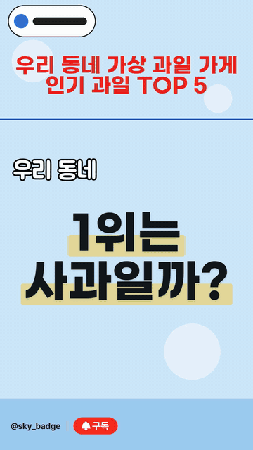
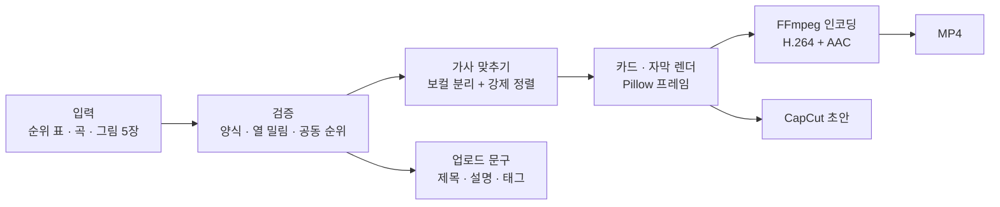

# ShortsMaker

[](https://github.com/diz99-art/ShortsMaker/actions/workflows/ci.yml)


**순위표 하나와 노래 한 곡을 넣으면, 가사에 맞춰 카드가 넘어가는 TOP 5 유튜브 쇼츠(1080×1920 MP4)와 CapCut 편집 초안을 만드는 프로그램.**

> **English summary** — ShortsMaker turns a ranked table (TOP 5) and a song into a vertical YouTube Shorts video.
> It parses and validates the table, aligns the sung lyrics with a local speech model, draws every frame with
> Pillow, encodes with FFmpeg, and also exports a CapCut draft and upload text. Built with Python, Pydantic and
> Streamlit. 304 tests, 89.8% coverage, and PR CI in under 3 minutes.

## 무엇을 해결하나

TOP 5 쇼츠 한 편을 만들 때마다 CapCut 에서 순위 카드 5장을 놓고, 노래를 들으며 가사 자막을 한 줄씩 손으로 맞췄다.
ShortsMaker 는 이 반복 작업을 자동으로 처리한다. 사람은 자료가 맞는지, 결과물이 괜찮은지만 확인한다.

- 입력: 순위 표(정해진 양식으로 붙여넣기) + 곡 파일 + 그림 5장
- 출력: MP4 + CapCut 초안 + 업로드용 제목·설명·태그

## 결과

<!-- 캡처를 넣으면 아래 주석을 풀기:  -->
- 데모 영상 GIF: (작성 예정 — `make demo` 결과로 만들 캡처 목록은 [docs/images](docs/images/README.md))
- 실제 업로드 영상 링크: (작성 예정)

| 항목 | 값 | 기준 |
|---|---|---|
| 테스트 | **304개** | `pytest` 로컬 전체 실행. GitHub CI main 전체 실행은 301개 통과, 3개 건너뜀 (가사 모델이 없는 환경) |
| 커버리지 | **89.8%** | main 전체 실행. 89% 아래로 떨어지면 CI 실패 |
| PR CI 시간 | **16분 5초 → 2분 41초~2분 57초** | 렌더 테스트 분리·패키지 캐시 ([기록](docs/decisions.md)) |
| 코드 규모 | 본체 37개 모듈 11,124줄 · 화면 1,706줄 · 테스트 27개 파일 3,607줄 | `wc -l` (빈 줄·주석 포함) |
| 렌더 시간 | 60초 영상 약 36초 · 54초 영상 약 9초 · 30초 데모 약 5초 | Apple M2 Pro, 렌더 단계만 (가사 맞추기 제외) |
| 손 작업 vs 자동 | (작성 예정) | 같은 영상 한 편 기준 |

## 동작 흐름



자세한 모듈 구조는 [docs/architecture.md](docs/architecture.md).

## 빠른 시작 (macOS)

```sh
brew install ffmpeg
git clone https://github.com/diz99-art/ShortsMaker.git && cd ShortsMaker
make setup     # .venv + 패키지 + 공개 폰트(OFL)·효과음·샘플 준비
make demo      # examples/demo 의 가짜 자료로 30초 영상 → output/demo.mp4
```

화면은 `.venv/bin/streamlit run app.py`. 화면별 사용법은 [docs/usage.md](docs/usage.md).

## 주요 기능

- **빠른 제작**: 양식 답변 + 곡 + 그림 5장 → 버튼 한 번으로 시험 렌더까지. 문제가 있을 때만 멈추고 묻는다
- **입력 검증**: 줄 번호가 붙은 오류 메시지, 표 열 밀림 감지, 공동 순위 규칙(1, 2, 2, 4, 5), 가사와 표 대조
- **가사 타이밍 자동 맞추기**: demucs 로 보컬을 분리하고 stable-ts(faster-whisper)로 강제 정렬. 로컬에서만 돌고 유료 API 를 쓰지 않음
- **자막 숫자 변환**: 노래는 한글 숫자로 부르고 자막은 아라비아 숫자로 표시 ('오십육 홈런' → '56홈런'). 사람·팀 이름은 바꾸지 않음
- **템플릿**: 좌표·색·글꼴을 `templates/<채널>/template.json` 에 둔다. 채널을 추가할 때 코드를 고치지 않음
- **연출 바꾸기**: 18가지 연출 요소(전환·강조색·자막 등장·효과음 등)를 조합하고, 최근 5편과 3요소 이상 다른 조합만 고른다 (반복형 영상 방지)
- **권리·기록**: 렌더 전 권리 체크리스트, 사람이 고친 내용을 `production_log.json` 에 기록
- **CapCut 초안**: 같은 배치를 편집 가능한 트랙으로 (비공식 라이브러리라 실패해도 MP4 에는 영향 없음)

## 기술 스택

- Python 3.12 · Pydantic v2(스키마·검증) · Pillow(프레임 그리기) · FFmpeg/ffprobe(`subprocess` 로 직접 호출)
- Streamlit(화면) · librosa(박자) · stable-ts + faster-whisper + demucs(가사 정렬, 선택 설치) · pyCapCut(CapCut 초안)
- pytest(+ xdist, cov) · ruff · mypy · pre-commit · GitHub Actions

## 폴더 구조

```
app.py, pages/          Streamlit 화면 (노래로 자동 제작 · 가사 만들기 · 빠른 제작)
shortsmaker/            본체
  models.py               pydantic 스키마 (프로젝트·템플릿)
  quick_parse*.py         양식 답변 → 표 (줄 번호 오류)
  rank_extract.py         가사 → 순위 표, 한글 숫자 변환, 열 밀림 검사
  lyrics_align.py         가사 타이밍 자동 맞추기
  card_timing.py          장면·글자 시각 계산
  card_layers.py          화면 요소 그리기
  card_mode.py            프레임 렌더 → FFmpeg 인코딩
  capcut_export.py        CapCut 초안
  variation.py            연출 바꾸기
templates/<채널>/       template.json (좌표·색·글꼴)
examples/demo/          저작권 문제 없는 데모 자료
scripts/                자산 준비·데모·검사 스크립트
tests/                  pytest (렌더 테스트는 @slow)
docs/                   architecture · decisions · usage · images
```

## 문제 해결 기록

버그마다 재현 테스트를 남겨 두었다. 아래 네 건은 **증상 → 원인 → 해결 → 추가한 테스트** 순서로 정리했다.

### 1. 자막에서 '이승엽'이 '2승엽'으로 바뀜

- **증상**: '1위 이승엽 오십육 홈런'을 부른 가사가 자막에 '1위 **2승엽** 56홈런'으로 나왔다.
- **원인**: 한글 숫자 변환이 '숫자 + 단위' 모양만 봤다. 이름 첫 글자 '이'(2)와 다음 글자 '승'(승리의 단위)을 숫자로 읽었다.
- **해결**: 선수·팀 이름을 변환 전에 자리표시로 빼 두었다가 되돌린다. 단위 바로 뒤에 조사가 아닌 한글이 이어지면
  낱말의 일부로 본다. 한 글자 숫자는 단위와 붙어 있을 때만 바꾼다 (`rank_extract.normalize_numbers`).
- **추가한 테스트**: `tests/test_rank_extract.py` 의 `test_numbers_never_touch_names`(8경우),
  `test_protect_list_and_extract_keeps_names`, `tests/test_quick.py` 에서 자막에 '2승엽'이 없는지 확인

### 2. 공동 순위가 있으면 영상을 만들 수 없음

- **증상**: 'FA 계약 TOP 5'처럼 공동 2위가 2명이면 3위가 없다. 그런데 프로젝트가 저장되지 않았고, 가사에서 뽑은 표는
  빈 3위 칸 때문에 확정되지 않았다.
- **원인**: 스키마가 "순위 1~5가 한 번씩"만 허용했다. 영상 속 자리(5→1 순서)와 화면에 보이는 순위를 같은 값으로 썼다.
- **해결**: 자리(`rank`)와 보이는 순위(`display_rank`)를 나눴다. 공동 순위 규칙(1, 2, 2, 4, 5)을 검사하는 함수를 두고,
  공동 순위 때문에 원래 없는 순위는 빈 행으로 만들지 않는다 (`models.competition_ranks_ok`, `rank_extract.extract_ranks`).
- **추가한 테스트**: `test_tie_rule`, `test_competition_ranks_edges`, `test_tie_slots_and_labels`,
  `test_extract_fa_tie_two_players_no_third`, `test_skipped_rank_after_tie` (`tests/test_rank_extract.py`),
  양식의 '공동 3위' 칸 읽기 `test_tied_rank_cells` (`tests/test_quick_parse.py`)

### 3. 기록 칸에 이름이 들어간 표 열 밀림을 못 잡음 ([PR #2](https://github.com/diz99-art/ShortsMaker/pull/2))

- **증상**: `5 | 박병호 | 넥센 히어로즈 | 박병호 | 2014`처럼 기록 칸에 선수·팀 이름이 들어가도 검사를 통과했다.
  그대로 두면 카드의 기록 자리에 이름이 찍힌다.
- **원인**: 열 밀림 검사가 선수 칸의 숫자, 팀 칸의 선수 이름, 연도 칸의 문장만 봤다. 기록 칸 규칙이 없었다.
- **해결**: 기록 칸 값이 표의 선수 이름이나 구단 이름·줄임말·별칭과 **정확히** 같으면 경고한다.
  '삼성전 5연승'처럼 팀 이름이 섞인 진짜 기록은 통과시킨다 (`rank_extract.column_problems`).
- **추가한 테스트**: `test_name_in_record_column_detected`(4경우), `test_real_records_pass`(5경우).
  고치기 전에 실패하는 테스트를 먼저 커밋했다

### 4. 오류 메시지에 이유 대신 문서 주소만 보임 ([PR #2](https://github.com/diz99-art/ShortsMaker/pull/2))

- **증상**: 양식의 보너스 줄 칸이 모자라면 `11번째 줄: 보너스 — For further information visit https://errors.pydantic.dev/…`만 나왔다.
- **원인**: pydantic `ValidationError` 의 문자열은 "오류 개수 / 이유 / 문서 URL" 3줄이다. 코드는 한 줄짜리 오류처럼
  마지막 줄만 잘라 썼다.
- **해결**: `ValidationError` 는 따로 받아 `e.errors()` 의 이유 문장을 보여 준다 (`quick_parse.parse_quick`).
  → `11번째 줄: 보너스 — 보너스 순위 장면은 순위·이름·기록이 필요합니다`
- **추가한 테스트**: `test_bonus_error_message_says_why` (먼저 xfail 로 남겨 둔 것을 정식 테스트로),
  `test_bonus_format_error_message` (형식 오류 메시지는 그대로인지)

## 개발 방식

AI 코딩 도구 두 개를 썼다. 무엇을 만들지와 무엇을 받아들일지는 내가 정했다.

- **나**: 설계서(`CLAUDE.md`)와 단계별 요구사항 작성, 범위·디자인 결정, 결과 영상 직접 확인, PR merge 결정
- **Claude Code**: `main` 브랜치에서 대부분의 기능 구현과 리팩터링, 테스트 작성
- **Codex**: 별도 작업 폴더(git worktree, `codex/work` 브랜치)에서 맡은 파일만 작업. CapCut 초안 호환성 시험·편집
  패키지, 정보 채널 양식 파서(`quick_parse_info.py`), YouTube 업로드 모듈(아직 main 에 합치지 않음)
- 두 도구가 같은 규칙을 읽도록 `CLAUDE.md` 와 `AGENTS.md` 에 같은 협업 규칙을 둔다
  (Codex 는 main 에 직접 커밋하지 않음, 맡은 파일 밖은 묻고 고침, hook 검사 우회 금지)

AI 가 만든 코드를 그대로 믿지 않으려고 아래 방법으로 검증했다.

- **테스트 먼저**: 버그는 실패하는 재현 테스트를 먼저 커밋(`test:`)하고 고쳤다(`fix:`)
- **렌더 프레임 비교**: 리팩터링 전후에 같은 프로젝트 3개를 렌더해 프레임 4,320장의 해시(framemd5)와 오디오 해시가
  완전히 같은지 비교했다 (모듈 분리, 타입 정리, 버그 수정 때마다)
- **PR + CI**: 모든 변경은 PR 로 올리고 ruff → mypy → pytest 가 통과해야 merge
- **push 보호**: `pre-push` hook 이 정리 전 옛 기록, 개인 이메일, 허용하지 않은 브랜치의 push 를 막는다.
  커밋 전에는 폰트·노래·그림·비밀 파일을 막는 검사가 돈다
- **직접 확인**: 영상은 사람이 보고 판단해야 해서 결과 영상과 CapCut 초안은 직접 열어 봤다

솔직히 적으면, 초반(2026-10-09~12)에는 기능을 빨리 늘리느라 큰 커밋에 여러 기능을 함께 넣었다.
테스트 먼저·PR·CI·프레임 비교는 공개를 준비하며(2026-10-13~) 정착한 방식이다.

## 앞으로 할 일

- Codex 브랜치의 YouTube 업로드 모듈(OAuth, dry run)을 정리해서 합치기
- mypy 엄격 검사 범위 넓히기 (지금은 핵심 모듈만, [이유](docs/decisions.md))
- 큰 모듈 나누기: `auto_pipeline.py` (1,306줄)
- CapCut 수동 가져오기 키트와 편집 패키지를 하나로 합치기
- 손 작업 대비 제작 시간 측정해서 위 표 채우기

## 문서

- [docs/architecture.md](docs/architecture.md) — 모듈 구조와 데이터 흐름
- [docs/decisions.md](docs/decisions.md) — 설계 결정과 이유
- [docs/usage.md](docs/usage.md) — 화면·명령줄 사용법, 템플릿, 검증 규칙 전체
- [docs/capcut-compatibility.md](docs/capcut-compatibility.md) — Mac CapCut 초안 호환성 시험 기록

폰트·노래·그림은 저장소에 넣지 않는다. 폰트는 `make setup` 이 공식 배포처에서 받는다 ([assets/fonts](assets/fonts/README.md)).
