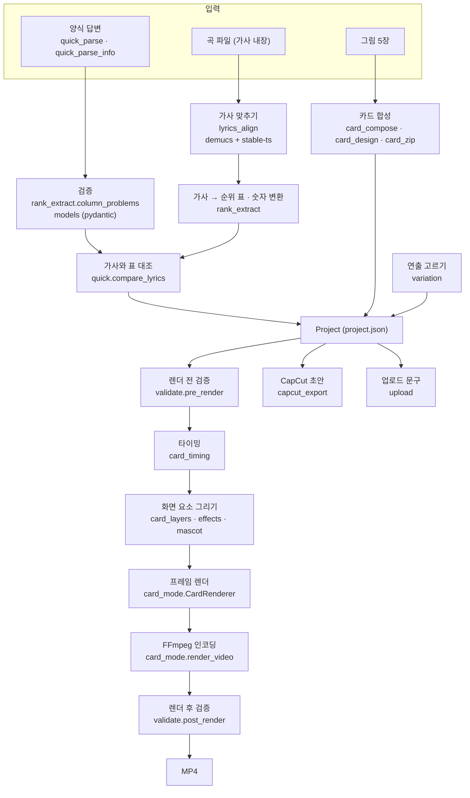

# 구조

ShortsMaker 가 입력을 받아 영상을 만들기까지 거치는 모듈과 데이터 흐름을 정리한 문서.
설계 이유는 [decisions.md](decisions.md), 사용법은 [usage.md](usage.md).

## 한눈에

## 계층

1. **화면·명령줄**: `app.py`, `pages/*.py`(Streamlit), `shortsmaker/cli.py`. 화면 코드는 상태를 보여 주고 버튼을 받기만 한다.
   실제 작업은 아래 계층의 함수를 부른다. CLI 와 화면이 같은 함수(`pipeline.render`)를 쓴다.
2. **작업 흐름**: `auto_pipeline.py`(노래로 자동 제작, 단계별 상태를 `auto.json` 에 저장), `quick.py`(빠른 제작, 한 번에 시험
   렌더까지), `pipeline.py`(검증 → 렌더 → 결과 검증).
3. **도메인 로직**: 양식 읽기, 순위 표, 숫자 변환, 가사, 연출, 검증. 파일·화면을 모르는 순수 함수가 대부분이라 단위 테스트가 쉽다.
4. **그리기·인코딩**: Pillow 로 프레임을 그리고 FFmpeg 로 인코딩한다.
5. **외부 연동** (모두 선택): 로컬 가사 정렬 모델, pyCapCut, 위키미디어 공용 사진 검색, OpenAI 이미지(비용 승인 후).
   하나가 없거나 실패해도 MP4 만들기는 동작한다.

## 데이터 모델 (`shortsmaker/models.py`)

- `Project`: 영상 한 편. 제목, 항목 5개(`Item`), 음악, 가사(`LyricLine`), 출처, 권리 확인, 연출(`Variation`)
  - 검증 규칙을 모델 안에 둔다: 항목 5개, 공동 순위 규칙(`competition_ranks_ok`), 가사 구간, 영상 길이 상한
  - `Item.rank` 는 영상 속 자리(5→1 순서로 한 번씩), `Item.display_rank` 는 화면에 보이는 순위(공동 2위 → 2, 2)
- `LyricLine`: 자막 한 줄. 시작·끝, 표시 글자(`text`), 실제로 부른 원문(`sung`), 단어 시각(`words`)
- `Template`: 채널 하나의 배치. 좌표 박스·색·글꼴·효과. `mode` 가 `classic` 이면 장면 클립 방식,
  `card` 면 프레임 직접 그리기 방식. `card_layout`·`lyrics_box` 속성이 모드에 맞는 설정만 돌려준다
- 양식 결과는 `QuickData`(`quick_parse.py`), 표 한 행은 `RankRow`(`rank_extract.py`)

## 렌더 방식 두 가지

- **classic** (`yagu`, `info_top5` — 첫 버전): `timeline.build_timeline` → `scenes.py` 가 장면별 PNG 레이어 →
  `ffmpeg_builder` 가 장면 클립(줌인·순위 팝)을 만들고 xfade 로 잇고 가사·음악을 합친다
- **card** (`yagu_v2`, `yagu_v2_sticker`, `info_v2`, `sky_badge` — 지금 쓰는 방식):
  - `card_timing`: 가사 단어 시각 → 글자별 시각(`char_times`), "5위"를 부르는 순간 → 장면 시작(`rank_times`),
    보너스·그래프·엔딩 시작, 효과음 시점
  - `card_layers`: 고정 화면(로고·제목·구분선), 움직이는 카드, 한 글자씩 나타나는 자막, 빨간 기록 줄
  - `card_mode.CardRenderer`: 프레임 번호 → 이미지. `state(i)` 가 프레임 모양을 정하는 값을 돌려주고,
    값이 이전 프레임과 같으면 그리지 않고 재사용한다 (정지 구간이 많은 영상은 렌더가 빠른 이유)
  - `card_mode.render_video`: 프레임을 raw RGB 로 FFmpeg 표준 입력에 흘려 넣고, 음악·효과음을 섞어 H.264/AAC 로 인코딩

## 주요 흐름

### 빠른 제작 (`quick.run_quick`)

1. `quick_parse.parse_quick`: 양식 답변 → 제목·출처·표·메모. 틀린 줄은 "4번째 줄: 칸이 5개입니다 (6개 필요)"처럼 모은다
2. 곡 등록 → `lyrics_align` 으로 가사 맞추기
3. `quick.compare_lyrics`: 가사에서 부른 순위·기록이 표와 다르면 멈추고 묻는다
4. 그림 배경 제거(`bg_remove`) → 카드 합성 → 연출 추천(`variation.suggest`) → 시험 렌더(`_DRAFT`)

### 가사 맞추기 (`lyrics_align`)

- `separate_vocals`(demucs) → `align_lines`(stable-ts 강제 정렬: 받아쓰기가 아니라 아는 가사가 '언제' 불렸는지 찾음)
  → `refine_onsets`(보컬 음량이 커지는 순간으로 단어 시작 보정) → `to_video_lyrics`(곡 시간 → 영상 시간)
- 무거운 패키지는 `requirements-align.txt` 로 분리. 정렬 함수는 `aligner` 인자로 바꿔 끼울 수 있어서, 테스트는 가짜 정렬기로 같은 흐름을 검사한다

### 자막 숫자 (`rank_extract`)

- `normalize_numbers`: '오십육 홈런' → '56홈런'. 이름은 자리표시로 빼 두고 되돌린다
- `display_text`: 표의 기록 숫자와 같은 값이면 단위 없이도 바꾼다
- 자막 줄의 `sung`(원문)과 `text`(표시)가 길이가 달라도, 바뀐 부분은 원래 부른 시간 안에서 고르게 나뉘어 나온다

## 검증이 있는 곳

- 입력: `quick_parse*`(줄 단위 오류), `rank_extract.column_problems`(열 밀림), `rank_extract.rows_complete`(빈칸·순위 규칙)
- 모델: pydantic 검증기 (`models.py`)
- 렌더 전: `validate.pre_render` (파일 존재, 글꼴, 가사 겹침, 글자 넘침, 권리 확인)
- 수익화용 렌더 전: `auto_pipeline` 의 권리 체크리스트 (Mock 아님, 표 확정, 사진·데이터 출처, 가사 검사, 연출 중복)
- 렌더 후: `validate.post_render` (ffprobe 로 해상도·길이·오디오)

## 테스트

- `tests/` 27개 파일, 304개. 렌더가 들어가는 11개는 `@pytest.mark.slow`
- 핵심 로직(양식·순위·숫자·가사)은 단위 테스트, 렌더는 짧은 실제 MP4 를 만들어 ffprobe 로 확인
- 흐름 테스트는 가짜 정렬기(`aligner` 인자)를 쓰고, demucs 가 없는 환경에서는 `tests/conftest.py` 가 보컬 분리를 원곡 복사로 대신한다
- CI: PR 은 slow 제외, main·수동 실행은 전체 + 커버리지 하한 89% ([decisions.md](decisions.md))
